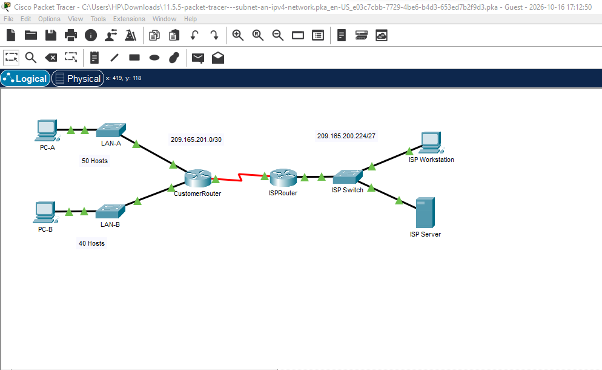

# CCNA_Subnetting_an_Ipv4_Network
This Lab Show A Design of an Ipv4 Network subnetting Scheme , Device configuration , Testing and troubleshooting

# Packet Tracer: Subnet an IPv4 Network

Subnetting `192.168.0.0/24` into equal-sized subnets for a customer network (two LANs plus spare subnets for growth), then configuring the router, switches, and PCs and verifying connectivity with ping.

## Objectives
1. Design an IPv4 subnetting scheme
2. Configure the devices
3. Test and troubleshoot the network

## Network Topology



## Part 1: Subnetting Design

**Requirements**
- LAN-A: at least 50 hosts
- LAN-B: at least 40 hosts
- At least 2 unused subnets for future expansion
- No VLSM (all masks the same length)

| Question | Answer |
|---|---|
| Hosts needed in largest subnet | 50 |
| Minimum number of subnets | 4 (LAN-A, LAN-B, 2 spare) |
| /24 mask in binary | `11111111.11111111.11111111.00000000` |
| Ones in the mask represent | Network portion |
| Zeros in the mask represent | Host portion |

**Mask comparison**

| Prefix | Dotted Decimal | Subnets | Hosts/Subnet |
|---|---|---|---|
| /25 | 255.255.255.128 | 2 | 126 |
| /26 | 255.255.255.192 | 4 | 62 |
| /27 | 255.255.255.224 | 8 | 30 |
| /28 | 255.255.255.240 | 16 | 14 |
| /29 | 255.255.255.248 | 32 | 6 |
| /30 | 255.255.255.252 | 64 | 2 |

- Masks meeting the host requirement (≥ 50): **/25, /26**
- Masks meeting the subnet requirement (≥ 4): **/26, /27, /28, /29, /30**
- Mask meeting both: **/26 (255.255.255.192)**

**Subnets**

| Subnet Address | Prefix | Subnet Mask | Assignment |
|---|---|---|---|
| 192.168.0.0 | /26 | 255.255.255.192 | LAN-A |
| 192.168.0.64 | /26 | 255.255.255.192 | LAN-B |
| 192.168.0.128 | /26 | 255.255.255.192 | Spare (future) |
| 192.168.0.192 | /26 | 255.255.255.192 | Spare (future) |

## Addressing Table

| Device | Interface | IP Address | Subnet Mask | Default Gateway |
|---|---|---|---|---|
| CustomerRouter | G0/0 | 192.168.0.1 | 255.255.255.192 | N/A |
| CustomerRouter | G0/1 | 192.168.0.65 | 255.255.255.192 | N/A |
| CustomerRouter | S0/1/0 | 209.165.201.2 | 255.255.255.252 | N/A |
| LAN-A Switch | VLAN1 | 192.168.0.2 | 255.255.255.192 | 192.168.0.1 |
| LAN-B Switch | VLAN1 | 192.168.0.66 | 255.255.255.192 | 192.168.0.65 |
| PC-A | NIC | 192.168.0.62 | 255.255.255.192 | 192.168.0.1 |
| PC-B | NIC | 192.168.0.126 | 255.255.255.192 | 192.168.0.65 |
| ISPRouter | G0/0 | 209.165.200.225 | 255.255.255.224 | N/A |
| ISPRouter | S0/1/0 | 209.165.201.1 | 255.255.255.252 | N/A |
| ISPSwitch | VLAN1 | 209.165.200.226 | 255.255.255.224 | 209.165.200.225 |
| ISP Workstation | NIC | 209.165.200.235 | 255.255.255.224 | 209.165.200.225 |
| ISP Server | NIC | 209.165.200.240 | 255.255.255.224 | 209.165.200.225 |

## Part 2: Device Configuration

### CustomerRouter

```
Router> enable
Router# configure terminal
Router(config)# hostname CustomerRouter
CustomerRouter(config)# enable secret Class123
CustomerRouter(config)# line console 0
CustomerRouter(config-line)# password Cisco123
CustomerRouter(config-line)# login
CustomerRouter(config-line)# exit
CustomerRouter(config)# interface g0/0
CustomerRouter(config-if)# ip address 192.168.0.1 255.255.255.192
CustomerRouter(config-if)# no shutdown
CustomerRouter(config-if)# exit
CustomerRouter(config)# interface g0/1
CustomerRouter(config-if)# ip address 192.168.0.65 255.255.255.192
CustomerRouter(config-if)# no shutdown
CustomerRouter(config-if)# end
CustomerRouter# copy running-config startup-config
```


### LAN-A Switch

```
Switch(config)# interface vlan 1
Switch(config-if)# ip address 192.168.0.2 255.255.255.192
Switch(config-if)# no shutdown
Switch(config-if)# exit
Switch(config)# ip default-gateway 192.168.0.1
```


### LAN-B Switch

```
Switch(config)# interface vlan 1
Switch(config-if)# ip address 192.168.0.66 255.255.255.192
Switch(config-if)# no shutdown
Switch(config-if)# exit
Switch(config)# ip default-gateway 192.168.0.65
```


### PCs

| PC | IP | Mask | Gateway |
|---|---|---|---|
| PC-A | 192.168.0.62 | 255.255.255.192 | 192.168.0.1 |
| PC-B | 192.168.0.126 | 255.255.255.192 | 192.168.0.65 |


## Part 3: Testing

| Test | Result |
|---|---|
| PC-A → default gateway (192.168.0.1) | Success |
| PC-B → default gateway (192.168.0.65) | Success |
| PC-A → PC-B | Success |


> The first ping may time out while ARP resolves; later replies confirm connectivity.

## Key Takeaways
- /26 was the only mask that satisfied both the host count (62 usable) and subnet count (4) with a uniform mask.
- Assigning the first host to the router, second to the switch, and last to the PC keeps addressing predictable.

## Files
- `Subnet_IPv4_Network.pka`: Packet Tracer activity file
- `images/`: screenshots
